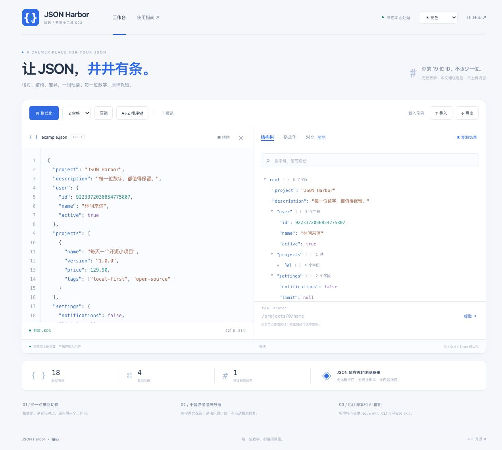

# JSON Harbor · 拾码

**让 JSON，井井有条。每一位数字，都值得保留。** 一个在浏览器本地运行的 JSON 工作台，提供相同核心的 Node API / CLI 与 AI skill。

[在线工具](https://batype.github.io/jsonharbor/) · [需求分析](docs/需求分析.md) · [AI Skill](skills/jsonharbor/SKILL.md) · [MIT 许可](LICENSE)



[查看暗色外观](assets/preview-dark.png)

## 为日常开发准备的五件事

- **格式化、压缩、递归排序键**：保留数字和字符串字面量，不通过 JavaScript Number 重新序列化。
- **严格校验和错误定位**：中文错误信息，行、列和源码偏移；不自动猜测修复。
- **结构树、搜索和路径提取**：惰性展开大节点，JSON Pointer 复制与提取。
- **结构差异**：新增、删除、修改；忽略对象键顺序，数组按下标，数字按字面量比较。
- **本地工作台**：亮 / 暗 / 跟随系统，响应式布局，导入、拖入、剪贴板复制和文件导出。

19 位 ID `9223372036854775807`、小数 `2.370`、指数 `2.3e+500` 和负零 `-0` 在格式化 / 压缩后都保持原始写法。重复键不会被静默覆盖：格式化保留所有成员并提示，歧义路径和结构对比会拒绝执行。

## 本地运行

Node.js >=20，无运行依赖，不需要 npm install。

```sh
git clone https://github.com/batype/jsonharbor.git
cd jsonharbor
npm test
npm run build
npm run dev
```

打开 http://127.0.0.1:4180/ 。使用 HTTP 服务访问，不能直接双击 HTML：浏览器需要加载 ES Modules 和 Module Worker。

`dist/` 是直接维护的前端源文件。`npm run build` 生成网页中的源码下载 ZIP；将整个 `dist/` 目录部署到静态站点即可。GitHub Pages 在 main 推送后自动测试并部署，PR 仅测试。资源均为相对路径，支持仓库子路径。

## Node API / CLI

已发布至 [npmjs：@batype/jsonharbor](https://www.npmjs.com/package/@batype/jsonharbor)。Node.js >=20，零运行依赖。

```sh
npm install @batype/jsonharbor
npx jsonharbor format input.json --indent 2 --out pretty.json
npx jsonharbor minify input.json --out compact.json
npx jsonharbor validate input.json
npx jsonharbor get input.json '/projects/0/name'
npx jsonharbor diff before.json after.json --json
```

也可直接执行 `npx --yes --package=@batype/jsonharbor jsonharbor validate input.json`，或从 GitHub 安装 `npm install github:batype/jsonharbor#v1.0.0`。

也可在仓库中直接运行 `node bin/jsonharbor.mjs`。输入省略或使用 `-` 时从 stdin 读取：

```sh
cat input.json | node bin/jsonharbor.mjs format - --sort
```

已有输出默认受到保护，`--force` 才允许替换；输入文件及其链接始终受到保护。Diff 退出码：0 相同，1 有差异，2 执行失败；其他命令 0 成功、2 失败。校验命令输出统计与重复键警告。

```js
import { formatJson, minifyJson, parseDocument, extractJson, diffJson } from '@batype/jsonharbor';

const text = '{"id":9223372036854775807,"price":2.370}';
console.log(formatJson(text, { indent: 2, sortKeys: true }));
console.log(minifyJson(text));
console.log(extractJson(text, '/id')); // 原文数字的字符串表示
console.log(diffJson(text, '{"id":9223372036854775808,"price":2.370}'));
```

`parseDocument()` 返回带源码位置、数字原文和有序成员的 AST，**不是**普通 JavaScript 对象，避免数值舍入、键覆盖或原型键副作用。类型声明见 [node/index.d.ts](node/index.d.ts)。不要在处理结果之后又用原生 `JSON.parse` 把长整数转为 Number。

### 路径与对比规则

使用 JSON Pointer，不声称支持完整 JSONPath：

- `/projects/0/name` 表示数组第 0 项的 name。
- 键名中的 `/` 转义为 `~1`，`~` 转义为 `~0`。
- 空路径表示根值，`/` 表示空字符串键名。
- 数组下标不能带前导零，也不支持 `-`。

对象键顺序不同不算差异，字符串不同转义但相同解码值不算差异。`1` 和 `1.0` 算不同数字字面量。数组使用下标，不提供智能移动检测。默认最多报告 500 处差异（API 可设置 1–5000），`truncated` 明确标记截断。报告中的 `before` / `after` 是 JSON 原文字符串，不是可能被舍入的数值对象。

## AI Skill

[skills/jsonharbor/SKILL.md](skills/jsonharbor/SKILL.md) 提供自然语言到 CLI 的操作说明，可由支持 SKILL.md 与本地命令的 AI 安装。Codex 可以使用 skill-installer 从该 GitHub 路径安装。

```text
$jsonharbor 把这个 JSON 格式化并按键排序，保留长 ID，不覆盖原文件。
$jsonharbor 比较 before.json 和 after.json，列出字段级差异。
```

## 隐私与资源限制

- 不上传 JSON，不加入分析统计，不将输入或文件名写入持久化存储；只保留界面外观偏好。编辑内容在页面内存中，刷新即释放。
- 网页解析、格式化、搜索和对比在本地 Web Worker 中执行。托管服务的普通访问日志由托管平台管理。
- UTF-8 输入和转换结果最大 2 MiB，最多 128 层、50000 个节点；不承诺超大文件编辑。树节点每批展开 100 项，搜索最多展示 200 条结果。
- 仅支持严格 JSON；不支持注释、尾逗号、JSON5、自动修复、Schema 校验或 YAML/XML 转换。
- 文件与 stdin 拒绝无效 UTF-8；输入中的 BOM 会被明确拒绝，不静默改写。
- 复制 / 读取剪贴板取决于浏览器安全上下文与权限，可直接粘贴或使用文件下载。

## 结构与许可

```text
dist/        网页、Module Worker、共享 JSON 引擎
bin/         CLI
node/        API 类型声明
tests/       引擎边界与 CLI 集成验证
skills/      AI skill
docs/        需求、发布素材与验证记录
scripts/     静态开发服务与源码 ZIP 构建
```

MIT © 2026 batype and contributors。问题和 PR 欢迎通过 GitHub 提交，请使用脱敏 JSON 复现。
